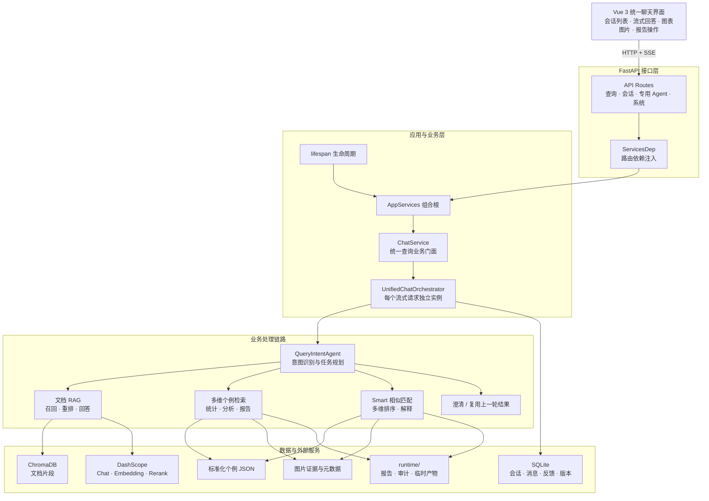

# 🌦️ 气象灾害个例智能分析系统

<p align="center">
  
  
  
  
  
  
</p>

<p align="center">面向气象业务的个例检索、灾害分析、证据追溯与报告生成平台</p>

基于大语言模型、向量检索和结构化个例数据的气象灾害问答与分析平台。系统面向气象业务人员，将 PDF 个例材料整理为可检索、可分析、可追溯的知识库，用户通过一个聊天入口即可完成统计汇总、过程复盘、区域分析、相似个例匹配、图片证据查看和报告导出。

> 当前版本：统一聊天主链路与模块化应用架构（2026 年 11 月）

## 🧩 项目简介

系统把气象灾害个例材料转换为三类可协同使用的知识资产：

| 数据形态 | 主要内容 | 主要用途 |
|----------|----------|----------|
| 📄 文档片段 | PDF 按自然段切分后的文本块 | 语义检索、材料问答和证据引用 |
| 📊 标准化个例 | 时间、灾种、区域、强度、影响等字段 | 统计、筛选、对比、分析和报告 |
| 🛰️ 图片证据 | 雷达图、卫星云图、降水图及来源页码 | 图片预览、证据追溯和报告配图 |

前端统一聊天页负责输入问题、展示流式回答和处理进度；后端根据问题意图自动选择文档 RAG、多维个例检索、Smart 相似匹配、澄清或报告处理链路。所有结果都可以保存到会话中，后续问题可承接上一轮个例范围和分析结果继续追问。

### ✨ 核心能力

- 🧠 **统一意图路由**：识别统计、检索、相似匹配、材料问答、复合任务和报告请求。
- ⚡ **流式回答与进度**：持续推送检索、分析、生成、保存等阶段事件和回答增量。
- 📊 **多维个例分析**：支持指标统计、逐例分析、图表、CSV 和 PDF 报告。
- 🔎 **Smart 相似匹配**：综合时间、空间、灾种、文本和图片等维度解释历史过程相似性。
- 🗂️ **会话上下文**：保存消息、个例范围、证据、图片、图表、报告和 Agent 运行信息。
- 🔁 **重生成与版本切换**：可附带本次重生成要求，并保留、切换查看历史回答版本。
- 💬 **消息操作**：支持复制、分享、反馈、问题上报、重新生成和 PDF 导出。

### 🧠 代码功能简要说明

| 模块 | 主要功能 |
|------|----------|
| ⚙️ `backend/app/main.py` | FastAPI 应用工厂，只负责 CORS、生命周期和路由装配 |
| 🧱 `backend/app/services/container.py` | `AppServices` 组合根，集中构造存储、模型客户端、查询服务和 Agent |
| 🔌 `backend/app/api/routes/agent.py` | 提供三个公开查询入口，统一委托 `ChatService` |
| 🛂 `backend/app/services/query/chat_service.py` | 三个查询入口共享的查询业务门面 |
| 🧭 `backend/app/agents/unified_chat/` | 统一编排、会话记忆、意图路由、进度事件、结果适配和持久化 |
| 🔎 `backend/app/agents/case_multidim_search/` | 按日期、年份、月份、灾种和区域检索个例，生成分析、图表和 PDF/CSV 报告 |
| 🧠 `backend/app/agents/smart_case_match/` | 综合时间、空间、灾种、文本和图片等维度返回相似历史个例及理由 |
| 🧩 `backend/app/agents/query_intent/` | 对复合问题进行意图识别、任务拆分和路由规划 |
| 📐 `backend/app/services/structured_qa.py` | 基于标准化个例回答统计、对比和证据清单等结构化问题 |
| 🏗️ `backend/app/services/knowledge_builder/` | 构建文档段向量、图片索引和标准化个例数据 |
| 💾 `backend/app/services/session_store.py` | 使用 SQLite 持久化会话、消息、Agent 运行记录、反馈、分享和回答版本 |
| 💬 `frontend/src/components/` | Vue 3 聊天界面、会话列表、处理进度、证据预览、报告卡和消息操作 |

## 🏗️ 系统架构



### 🧱 分层与依赖方向

| 层次 | 位置 | 职责 |
|------|------|------|
| 接口层 | `backend/app/api/` | 接收请求、注入服务、返回响应或 SSE，不包含查询业务实现 |
| 应用装配层 | `backend/app/main.py`、`backend/app/core/` | 创建 FastAPI 应用、管理生命周期、加载配置 |
| 业务服务层 | `backend/app/services/query/` | 文档问答、结构化查询、上下文解析、结果适配和统一门面 |
| Agent 层 | `backend/app/agents/` | 意图路由、统一编排、多维分析、相似匹配和领域处理 |
| 基础设施层 | `backend/app/services/` | 存储、模型客户端、知识库构建、会话与导出 |

依赖方向保持为“接口 → 应用服务 → Agent / 基础设施”。Router 通过 `ServicesDep` 获取 `AppServices`，不会反向导入 `main.py` 或持有应用全局状态。导入应用模块不会自动创建数据库、连接向量库或调用模型，这些动作只在 FastAPI `lifespan` 启动阶段执行。

### 🔄 唯一主业务链路

前端日常问答统一使用 `/api/query/stream`：

```text
Vue 统一聊天页
  → POST /api/query/stream
  → ChatService.stream
  → UnifiedChatOrchestrator.stream
  → QueryIntentAgent.route
  → document_rag | case_multidim_search | smart_case_match | clarify
  → 报告复用或流式结果适配
  → SSE 增量事件
  → 保存会话、证据、图片、图表、报告与版本信息
```

三个公开查询入口共享 `ChatService`：

| 入口 | 当前定位 | 说明 |
|------|----------|------|
| `POST /api/query/stream` | ✅ 唯一主业务链路 | 前端统一聊天入口，返回完整流式事件和会话记忆 |
| `POST /api/query` | 兼容旧客户端 | 复用结构化优先的文档查询服务 |
| `POST /api/agent/query` | 兼容旧智能体协议 | 返回意图、执行计划、证据和审计信息 |

专用 `/api/case-multidim`、`/api/smart-case-match` 和 `/api/query-intent` 接口继续保留，供独立页面、调试和外部系统直接调用，但不替代统一聊天主链路。

一次问答的典型过程：

1. 前端通过 `/api/query/stream` 提交问题，并立即显示处理中状态。
2. 编排器读取当前会话历史、结构化上下文和上一轮可复用结果。
3. 意图 Agent 识别问题并规划文档 RAG、多维检索、Smart 匹配或澄清链路。
4. 后端持续推送检索、分析、生成和保存阶段的进度与回答增量。
5. 结果写入 SQLite，会话保存回答、证据、图片、图表、报告和版本信息。
6. 用户可以继续追问、反馈、重新生成、分享或导出 PDF。

## 📁 项目结构

```text
├── backend/
│   ├── app/
│   │   ├── main.py                       # 应用工厂：CORS、生命周期和路由装配
│   │   ├── api/
│   │   │   ├── dependencies.py           # ServicesDep 依赖注入
│   │   │   ├── schemas.py                # 请求数据模型
│   │   │   └── routes/
│   │   │       ├── agent.py              # 三个公开查询入口
│   │   │       ├── sessions.py           # 会话、消息、反馈、分享和导出
│   │   │       ├── system.py             # 健康检查与知识库状态
│   │   │       ├── vectors.py            # 知识库重建与图片证据
│   │   │       ├── case_multidim.py      # 多维个例专用接口
│   │   │       ├── smart_case_match.py   # Smart 匹配专用接口
│   │   │       └── query_intent.py       # 意图路由专用接口
│   │   ├── core/
│   │   │   ├── config.py                 # 环境变量、目录与模型配置
│   │   │   └── lifecycle.py              # 服务容器生命周期
│   │   ├── agents/
│   │   │   ├── unified_chat/             # 统一编排、路由、流式处理和持久化
│   │   │   ├── query_intent/             # 意图识别与任务拆分
│   │   │   ├── case_multidim_search/     # 多维检索、分析、图表与报告
│   │   │   └── smart_case_match/         # Smart 相似个例匹配
│   │   └── services/
│   │       ├── container.py              # AppServices 组合根
│   │       ├── query/                    # 统一查询门面及查询业务服务
│   │       ├── model_client/             # Chat、Embedding、Rerank 客户端
│   │       ├── knowledge_builder/        # 文档、图片和标准化个例构建
│   │       ├── session_store.py          # SQLite 会话持久化
│   │       ├── document_store.py         # ChromaDB 文档片段存储
│   │       ├── image_extraction.py       # 图片证据存储
│   │       └── structured_qa.py          # 结构化问题回答
│   └── tests/                            # 后端单元、集成和架构测试
├── frontend/
│   ├── src/
│   │   ├── App.vue                       # 页面状态、SSE 和会话协同
│   │   ├── api.js                        # REST、SSE 和文件接口封装
│   │   ├── components/
│   │   │   ├── ChatPanel.vue             # 聊天面板组合入口
│   │   │   ├── chat/                     # 输入、消息、证据、操作和反馈组件
│   │   │   ├── SessionList.vue           # 会话列表
│   │   │   ├── SmartCaseResult.vue       # Smart 匹配结果
│   │   │   └── PdfReportCard.vue         # PDF 报告卡片
│   │   ├── messageVersions.js            # 回答版本分组与切换
│   │   └── styles/                       # 基础样式与回答内容样式
│   └── package.json
├── docs/                                 # 架构与设计说明
├── resource/                             # 待入库 PDF（不提交）
├── data/                                 # 知识库、图片和会话数据（不提交）
├── tests/                                # 场景验证脚本和本地验证产物
├── tmp/                                  # 本地运行截图（不提交）
├── requirements.txt
└── README.md
```

`runtime/`、`logs/`、`tmp/`、数据库、测试输出、截图、`data/numba_cache/` 和 `.codex_tmp/` 均已加入 `.gitignore`。实际运行数据应保留在本机或部署环境中，不进入版本库。

## ✨ 功能演示

以下截图来自本机 `tmp/` 目录。该目录已被 Git 忽略，因此本地 Markdown 预览可见，推送到远端仓库时不会自动包含图片；如需公开展示，应另行将截图上传到受版本管理的文档资源目录并替换链接。

### 🗺️ 区域分布与影响范围分析

用户直接提问，系统从标准化个例中汇总过程数量、影响范围、降温幅度和大风强度，并给出区域对比。


### 🌧️ 跨月份灾害特征总结

系统可以把多个时间段的个例合并分析，归纳降水强度、空间分布、地形效应和复合灾害特征。


### 🔬 单个过程的分阶段复盘

对于“详细分析某次灾害”这类问题，系统按时间阶段组织降水演变、强度指标、强对流表现和总体特征。


### 🛰️ 图片证据关联

回答会列出图片类型、来源 PDF、页码和图片 ID。前端支持点击图片 ID 预览对应的雷达图、降水图或其他证据图。


### 🧾 会话追问与消息操作

统计结果可以继续追问；回答保存后支持复制、分享、收藏/反馈、问题上报、重新生成和导出 PDF。


## 🚀 快速开始

### 🧰 环境要求

- Python 3.10 或更高版本
- Node.js 18 或更高版本和 npm
- 可访问 DashScope OpenAI 兼容接口的 API Key
- 构建知识库时预留足够的磁盘空间和模型调用配额

### 1️⃣ 创建虚拟环境并安装后端依赖

Windows PowerShell：

```powershell
python -m venv .venv
.\.venv\Scripts\Activate.ps1
python -m pip install -r requirements.txt
```

Linux/macOS：

```bash
python -m venv .venv
source .venv/bin/activate
python -m pip install -r requirements.txt
```

### 2️⃣ 配置环境变量

在项目根目录创建 `.env`：

```env
# 必填：DashScope API Key，也兼容 ALIYUN_API_KEY
DASHSCOPE_API_KEY=sk-xxxxxxxxxxxxxxxxxxxxxxxxxxxxxxxx

# DashScope OpenAI 兼容接口
DASHSCOPE_BASE_URL=https://dashscope.aliyuncs.com/compatible-mode/v1

# 模型配置，可按部署环境覆盖
DASHSCOPE_CHAT_MODEL=qwen-plus
DASHSCOPE_INTENT_MODEL=qwen-plus
DASHSCOPE_FOLLOWUP_MODEL=qwen-plus
DASHSCOPE_EMBEDDING_MODEL=text-embedding-v4
DASHSCOPE_RERANK_MODEL=qwen3-rerank

# 可选：重排序服务的独立地址
# DASHSCOPE_RERANK_ENDPOINT=

# 可选：多维分析报告和审计输出目录
# CASE_MULTIDIM_RUNTIME_DIR=backend/app/agents/case_multidim_search/runtime
```

代码会优先读取 `DASHSCOPE_API_KEY`，同时兼容旧配置名 `ALIYUN_API_KEY` 和 `ALiYunAPI`。

`.env` 已被 `.gitignore` 排除，请勿提交真实密钥。

### 3️⃣ 启动后端

```powershell
.\.venv\Scripts\uvicorn.exe backend.app.main:app --reload --host 127.0.0.1 --port 8000
```

后端地址：

- Swagger：<http://127.0.0.1:8000/docs>
- 健康检查：<http://127.0.0.1:8000/api/health>
- 知识库状态：<http://127.0.0.1:8000/api/knowledge/status>

### 4️⃣ 安装前端依赖并启动前端

```powershell
cd frontend
npm install
npm run dev -- --host 127.0.0.1 --port 5173
```

打开 <http://127.0.0.1:5173>。前端默认访问 `http://127.0.0.1:8000`；如后端地址不同，在 `frontend/.env.local` 中配置：

```env
VITE_API_ORIGIN=http://127.0.0.1:8000
```

### 5️⃣ 构建知识库

1. 将气象灾害 PDF 放入 `resource/`。
2. 确认后端和模型配置可用。
3. 调用知识库重建接口：

```powershell
Invoke-RestMethod -Method Post -Uri 'http://127.0.0.1:8000/api/documents/index'
```

该接口会重建自然段文档向量、图片证据索引和标准化个例数据。数据默认写入 `data/`，首次构建的耗时取决于 PDF 数量、图片数量和模型服务速度。

## 📖 使用说明

### 💬 统一聊天入口

打开前端后，在同一个输入框中直接使用自然语言提问。系统不要求用户先选择功能模块，会自动判断问题类型并选择对应 Agent。

可以尝试：

```text
2025年山西的寒潮主要分布在哪里，对哪些区域影响最大？
总结全年暴雨的主要特点和成因。
详细分析一下7月7日的灾害。
这次灾害关联了哪些图片？
2025年7月份发生了几次灾害？
当前山西北部出现强对流，历史上有哪些相似过程？
```

### 🛣️ 主要处理链路

| 问题类型 | 处理链路 | 典型结果 |
|----------|----------|----------|
| 📊 统计、筛选、对比和过程分析 | 多维个例检索 Agent | 个例列表、统计指标、强度分析、图表和证据 |
| 🧠 历史过程相似性和相似天气判断 | Smart Case Match Agent | 相似个例、匹配维度、相似度和解释 |
| 📄 材料问答、证据补充和开放性问题 | 文档 RAG | 流式文本回答、文档片段和关联图片 |
| 🧾 复用上一轮结果生成报告 | 报告处理链路 | 复用已保存的分析结论并生成 PDF 报告 |

### ⏳ 流式回答与处理中状态

提交问题后，页面会显示当前 Agent、阶段和百分比进度，例如检索证据、整理结构化事实、生成回答、保存结果。回答正文以 SSE 增量方式显示；在模型或部分外部服务不可用时，系统会尽量使用结构化数据和本地证据完成降级回答。

### 🖼️ 图片、图表与报告

- 回答中的图片 ID 可以点击预览原图。
- 统计和分析结果可以展示表格、柱状图等轻量可视化。
- 多维检索支持 CSV 导出和 PDF 报告生成。
- 对上一轮结果提出“整理成报告”或“导出 PDF”时，可复用已保存的分析结果，再进行本地 PDF 排版。

### 💾 会话、上下文和消息操作

- 左侧会话列表支持创建、重命名、切换和删除会话。
- 后续问题可以引用上一轮的个例范围、指标和分析结果。
- 已完成回答支持重新生成，可附带本次重生成要求，并通过版本导航查看旧答案。
- 支持复制、分享、正向/改进反馈、问题上报和 PDF 导出。

## 🔌 API 接口概览

### 🤖 查询接口

| 方法 | 路径 | 说明 |
|------|------|------|
| `POST` | `/api/query/stream` | ✅ 统一流式问答主入口 |
| `POST` | `/api/query` | 兼容旧客户端的非流式文档查询 |
| `POST` | `/api/agent/query` | 兼容旧智能体协议的结构化查询 |

流式入口示例：

```powershell
Invoke-RestMethod `
  -Method Post `
  -Uri 'http://127.0.0.1:8000/api/query/stream' `
  -ContentType 'application/json' `
  -Body '{"question":"2025年7月份发生了几次灾害","session_id":"your-session-id"}'
```

### 🩺 系统与知识库接口

| 方法 | 路径 | 说明 |
|------|------|------|
| `GET` | `/api/health` | 应用、向量库和模型基础状态 |
| `GET` | `/api/knowledge/status` | 个例数量、向量数量、模型和构建清单 |
| `POST` | `/api/documents/index` | 从 `resource/` 重建文档、图片和标准个例索引 |
| `GET` | `/api/image-evidence/{image_id}` | 获取聊天图片证据文件 |

### 💬 会话与消息接口

| 方法 | 路径 | 说明 |
|------|------|------|
| `POST` | `/api/sessions` | 创建会话 |
| `GET` | `/api/sessions` | 列出会话 |
| `GET` | `/api/sessions/{session_id}` | 获取单个会话 |
| `PATCH` | `/api/sessions/{session_id}` | 更新会话标题 |
| `DELETE` | `/api/sessions/{session_id}` | 删除会话 |
| `GET` | `/api/sessions/{session_id}/messages` | 获取会话消息和版本信息 |
| `GET` | `/api/sessions/{session_id}/agent-runs` | 查看 Agent 运行记录 |
| `POST` | `/api/sessions/{session_id}/messages/{message_id}/feedback` | 保存回答反馈 |
| `POST` | `/api/sessions/{session_id}/messages/{message_id}/report` | 上报回答质量问题 |
| `POST` | `/api/sessions/{session_id}/messages/{message_id}/share` | 创建分享链接 |
| `POST` | `/api/sessions/{session_id}/messages/{message_id}/export-pdf` | 导出单条回答 PDF |
| `GET` | `/api/shared-messages/{token}` | 获取分享内容 |

### 🤖 专用 Agent 接口

- `/api/case-multidim`：自然语言解析、结构化检索、进度、CSV/PDF 导出、报告和图片资源。
- `/api/smart-case-match`：相似匹配、自然语言流式会话、进度和证据资源。
- `/api/query-intent`：意图路由和知识库日期范围查询。

完整请求体和响应字段以运行中的 Swagger (`/docs`) 为准。根目录的 `API接口文档.md` 属于历史补充资料，如与当前路由不一致，请优先使用 OpenAPI。

## 🧪 开发与测试

### 后端

```powershell
.\.venv\Scripts\python.exe -m compileall backend/app backend/tests
.\.venv\Scripts\python.exe -m pytest backend/tests -q
```

重点验证应用架构：

```powershell
.\.venv\Scripts\python.exe -m pytest backend/tests/integration/api/test_architecture.py -q
```

架构测试覆盖应用工厂、路由依赖、Agent 包导入、服务生命周期和三个查询入口的统一委托关系。

### 前端

```powershell
cd frontend
npm run build
```

### 双端口联调

分别启动后检查：

- 后端健康接口：`http://127.0.0.1:8000/api/health`
- 知识库状态：`http://127.0.0.1:8000/api/knowledge/status`
- 前端聊天页：`http://127.0.0.1:5173`
- 统一 SSE 冒烟：向 `/api/query/stream` 提交一条轻量问题，确认收到 `data:` 事件。

根目录 `tests/` 还保留了历史场景验证脚本和本地验证产物，适合按需运行，不计入后端核心回归测试。

## ❓ 常见问题

### 没有配置 API Key 能否启动？

可以启动服务和查看部分本地接口，但涉及意图解析、Embedding、Rerank 或回答生成时可能无法调用云端模型。系统会在可用范围内退回规则、结构化数据或本地文档证据。

### 如何更新知识库？

把新 PDF 放入 `resource/` 后重新调用 `POST /api/documents/index`。该接口面向管理员使用，普通用户只需在聊天页提问。

### 为什么回答中有图片 ID 而没有图片？

请确认对应图片已经生成到 `data/document_images/`，并检查 `/api/image-evidence/{image_id}` 是否可访问。图片是增强证据，图片加载失败时文字回答仍会保留。

### 多维检索和 Smart 匹配是否还有独立页面？

后端保留 `/api/case-multidim` 和 `/api/smart-case-match` 专用接口，前端日常使用统一聊天入口。用户无需手动选择 Agent，系统会根据问题自动路由。

### 报告生成需要重新调用模型吗？

首次多维分析报告通常会调用逐例分析和图表生成流程；针对上一轮结果的报告请求会优先复用已保存的分析结果，再进行本地 PDF 排版。

### 为什么 README 截图在远端看不到？

演示图链接指向本机 `tmp/`，该目录按运行产物和截图策略被 `.gitignore` 排除。本地预览不受影响；发布仓库前需要把选定截图放入受版本管理的资源目录并更新链接。

### 旧查询接口还能继续使用吗？

可以。`/api/query` 和 `/api/agent/query` 保留原协议并共享 `ChatService`；新功能和完整流式交互应优先使用 `/api/query/stream`。

## 🔐 许可证与使用范围

本项目当前用于内部研究和业务验证。知识库中的 PDF、图片、模型密钥、会话数据库和报告可能包含内部资料，请按部署环境配置访问控制、网络边界和备份策略。

不要将 `.env`、`resource/`、`data/`、`runtime/`、`logs/` 或 `tmp/` 中的敏感内容提交到公共仓库。

---

**最后更新：2026 年 11 月**
