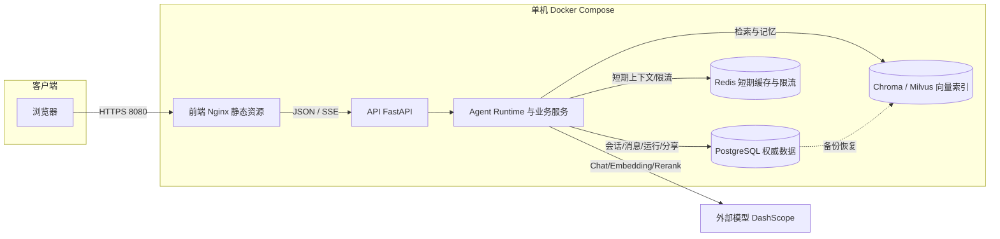
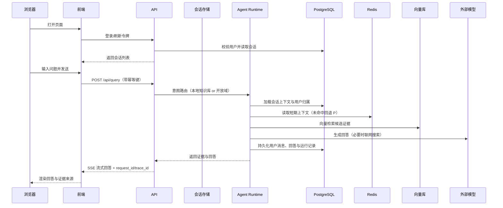

# 系统架构与请求链路

> 本文档用于面试讲解：先看整体架构，再看一条真实请求的完整链路，最后说明
> 模块化单体与单机部署的边界。所有文档与注释使用中文。

## 1. 总体架构

关键点：

- 前端是 Nginx 托管的静态构建产物，无业务状态。
- API 与 Agent Runtime 在同一进程内以模块化单体组织，避免微服务网络开销。
- PostgreSQL 是唯一权威数据源；Redis 与向量索引均可从权威数据重建。
- 外部模型只承担生成与检索重排，不保存业务事实。

## 2. 一条请求的完整链路

## 3. 边界与取舍

- 同一进程内的模块化单体：会话、意图、检索、生成按服务类分层，但共享一个
  FastAPI 生命周期与数据库连接池，适合单机演示与开发迭代。
- 降级边界：Redis 故障不影响历史会话，向量库故障有结构化检索回退，
  模型故障返回已核验证据或明确无答案，不会伪造结论。
- 可观测性：每个请求都有 `request_id` 与 `trace_id`，`/metrics` 暴露
  请求量、错误量、模型调用成功率、缓存/向量回退次数。
