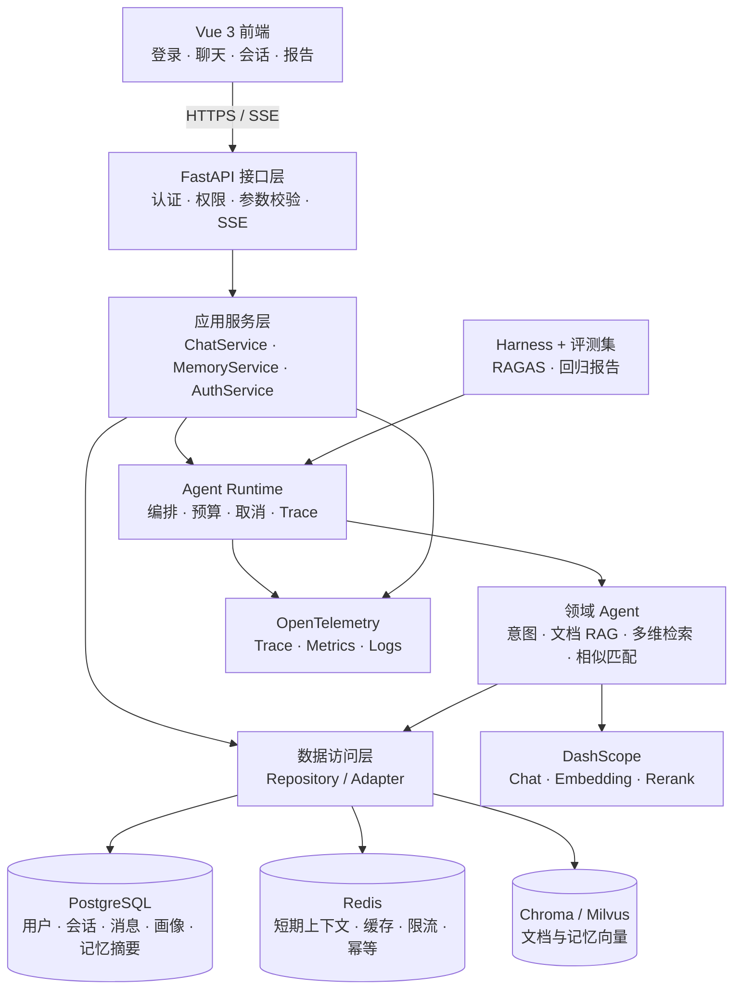

# 山西气象灾害个例智能分析系统企业化过渡实施方案

> **用途：**供后续开发者按阶段实施、测试和验收，不作为已完成能力说明。

**目标：**在不改变现有气象灾害查询、个例分析、文档问答和报告业务的前提下，将当前工程雏形逐步完善为可隔离、可持久化、可观测、可评测、可恢复和可重复部署的工程化 Agent 项目。

**架构：**继续采用模块化单体，以 FastAPI、Vue 3 和现有 Agent 编排链路为核心；PostgreSQL 保存权威业务数据，Redis 保存短期上下文与可重建缓存，Chroma 先作为默认向量存储，Milvus 在评测基线完成后作为可选增强实现；通过 OpenTelemetry、评测数据集和 Agent Harness 建立质量证据。

**技术栈：**Python、FastAPI、Vue 3、SQLAlchemy、Alembic、PostgreSQL、Redis、ChromaDB、Milvus、OpenTelemetry、RAGAS、Docker Compose。

**当前基线：**`main` 分支提交 `472d36e refactor: 统一应用架构与查询主链路`。项目已在 `backend/app/services/container.py` 建立服务组合根，在 `backend/app/main.py` 建立应用工厂，并以 `/api/query/stream` 作为统一流式业务入口。已有会话、消息、Agent 运行状态、反馈和分享快照的 SQLite 持久化能力，以及约 270 个后端测试函数。当前工作区仅存在未跟踪的 `.claude/`，本方案不处理该目录。

**实施日期：**2026-11-05

## 全局约束

1. 所有文档和代码注释使用中文。
2. 不改变现有气象灾害业务规则、检索结果、报告格式和前端用户可见交互；企业化基础设施以增量和适配方式接入。
3. 所有用户数据必须绑定用户身份，权限判断必须在 API 层和资源所有者边界执行，不能只依赖前端。
4. PostgreSQL 是用户、会话、消息、画像和长期记忆的权威事实源；Redis 不得成为历史消息的唯一存储。
5. Chroma 与 Milvus 均不得保存唯一业务事实，向量索引必须能够从权威数据重建。
6. 密钥、数据库地址、模型名称、端口和运行路径只通过现有配置体系或环境变量传入，真实密钥不得写入代码、日志、Trace 或版本库。
7. 新文件原则上控制在 100～300 行，复杂函数优先在 20～50 行；不为了压缩行数删除必要注释或制造零碎文件。
8. 新增或修改的公共函数、核心业务函数必须提供明确类型标注，避免无必要的 `Any`。
9. 不引入 Kubernetes、Kafka、独立微服务集群和真实高可用部署；“企业化”通过清晰边界、自动化验证、可恢复能力和工程取舍体现。
10. 每个阶段都必须形成可运行的垂直切片，不能先积压大量基础设施再统一接入。

---

## 1. 项目定位与当前结论

本项目是面向山西气象灾害个例的领域 Agent，不是招生 Agent，也不是电商 Agent。核心业务包括：

- 按年份、月份、日期、灾种和区域进行多维个例检索。
- 统计灾害次数、影响范围、强度指标并进行过程分析。
- 基于时间、空间、灾种、文本和图片证据进行相似个例匹配。
- 对 PDF 个例材料执行文档 RAG、证据引用和开放问答。
- 复用会话中的个例范围和分析结果生成图表、CSV 与 PDF 报告。
- 在一个统一聊天入口中完成意图识别、任务拆分、流式执行和会话持久化。

当前项目已经具备“领域 Agent 工程骨架”，但还不是完整的工程闭环。更准确的定位是：

> 这是一个完成基础分层、统一主链路和会话状态恢复的气象灾害 Agent 项目，正在从功能原型过渡到具有企业工程思想的单机部署项目。

面试时不需要声称达到真实企业规模，而应展示以下证据：

- 用户数据在 API 和存储层真正隔离。
- 一套命令可以重复启动系统。
- 一次问答有完整 Trace。
- 一组版本化数据可以重复评测。
- Chroma 与 Milvus 的迁移有指标和回退依据。
- 模型、Redis、向量库和数据库故障时有明确降级行为。
- 能解释为什么暂不引入微服务、Kubernetes 和 Kafka。

## 2. 当前能力盘点

| 能力 | 当前状态 | 当前实现与边界 | 企业化缺口 |
|---|---|---|---|
| 工程分层 | 基本完成 | `main.py` 负责应用装配，`AppServices` 负责依赖构造，业务服务通过构造函数注入 | 新增认证、数据库、缓存、Trace 和评测依赖时不回退为全局状态 |
| 统一业务链路 | 完成 | `/api/query/stream` 是主链路，旧查询接口保留兼容并共享 `ChatService` | 在所有入口增加身份、请求 ID、Trace ID 和统一错误协议 |
| Trace | 部分实现 | 已有运行耗时、审计 JSONL、`agent_runs` 和运行状态 | 缺少 OpenTelemetry 上下文传播、跨模型/检索/数据库调用链路和 Token 指标 |
| Harness | 部分实现 | 有常规单元、集成、架构测试和运行验证脚本 | 缺少统一 Agent 评测运行器、预算、工具白名单、取消、回放和失败归档 |
| 模型评测 | 未实现 | 没有版本化黄金数据集和自动回归报告 | 缺少路由、检索、回答证据、延迟和成本的统一指标 |
| RAGAS | 未实现 | 尚未接入自动 RAG 质量评估 | 缺少 Faithfulness、Context Recall、Context Precision 等补充指标 |
| 容器化 | 未实现 | 当前通过本地 Python 虚拟环境和 npm 启动 | 缺少 Dockerfile、Compose、迁移任务、健康检查和数据卷 |
| 持久化 | 部分实现 | `SessionStore` 使用 SQLite 保存会话、消息、运行、反馈和分享快照 | 缺少 PostgreSQL、迁移、用户画像、跨会话记忆和备份恢复 |
| 用户鉴权 | 未实现 | 无注册、登录、JWT、刷新令牌和登出 | 缺少可信用户身份、令牌轮换和失效机制 |
| 权限控制 | 未实现 | 会话接口只按 `session_id` 查找 | 会话、消息、运行、反馈和分享均缺少资源所有者校验 |
| 短期记忆 | 部分实现 | `ConversationMemoryManager` 在单个会话内生成压缩记忆 | 缺少 Redis 活跃上下文、TTL、缓存失效和重建 |
| 长期记忆 | 未实现 | 没有跨会话用户画像和偏好 | 缺少 PostgreSQL 权威记忆、Milvus 语义召回和记忆生命周期 |
| 故障恢复 | 部分实现 | 已有待确认 Agent 状态、部分重试和本地降级 | 缺少超时、预算、熔断、幂等、取消、失败重放和恢复演练 |
| 向量存储 | 部分实现 | `ChromaDocumentChunkStore` 支持 Chroma 和 JSON 余弦检索降级 | 缺少统一接口、Milvus 适配器、权限元数据和迁移评测 |
| 数据安全 | 未实现 | CORS 当前允许全部来源，上传、日志和分享缺少明确边界 | 缺少来源白名单、限流、敏感信息处理、审计和保留策略 |
| CI 与静态检查 | 未实现 | 当前测试和构建需要人工执行 | 缺少 CI、Ruff、Mypy、ESLint、Prettier 和自动回归门禁 |

## 3. 目标架构

### 3.1 总体结构

继续采用模块化单体。单体不等于代码混在一起，而是保留一个部署单元、一个业务应用边界，同时通过接口层、业务层、领域 Agent、数据访问层和外部服务适配器实现清晰依赖。



### 3.2 依赖方向

最终依赖方向固定为：

```text
API -> Application Service -> Agent Runtime / Domain Agent -> Repository / Adapter -> 外部服务
```

约束如下：

1. Router 只能依赖应用服务、认证依赖和请求模型，不能直接执行 SQL、拼接向量查询或调用模型提示词。
2. Application Service 负责用例编排、权限资源组合和事务边界，不依赖 FastAPI 的 `Request` 或 `HTTPException`。
3. Agent 负责领域判断和生成过程，不直接创建数据库连接，不读取全局应用变量。
4. Repository 和 Adapter 负责 PostgreSQL、Redis、Chroma、Milvus 和模型调用，不依赖 API 层。
5. `AppServices` 只负责依赖构造和释放，不承载业务流程。

### 3.3 建议新增目录

不一次性移动现有全部目录，只围绕新职责增加清晰边界：

```text
backend/
├── alembic/
│   └── versions/                     # PostgreSQL 结构迁移
├── app/
│   ├── api/
│   │   └── routes/
│   │       └── auth.py               # 注册、登录、刷新、登出、当前用户
│   ├── db/
│   │   ├── base.py                   # SQLAlchemy 基础模型与时间规范
│   │   ├── models.py                 # 数据库模型，不放业务流程
│   │   └── session.py                # 异步引擎与会话工厂
│   ├── security/
│   │   ├── passwords.py              # 密码哈希与验证
│   │   ├── tokens.py                 # 访问令牌和刷新令牌
│   │   └── permissions.py            # 角色与资源所有权判断
│   ├── repositories/
│   │   ├── session_repository.py     # 会话与消息数据访问
│   │   ├── memory_repository.py      # 画像、长期记忆和摘要
│   │   └── feedback_repository.py    # 反馈、问题上报和分享
│   ├── cache/
│   │   ├── redis_client.py           # Redis 连接适配
│   │   └── context_cache.py          # 短期上下文缓存接口
│   ├── observability/
│   │   ├── tracing.py                # Trace 初始化与 span 工具
│   │   ├── metrics.py                # 业务和模型指标
│   │   └── logging.py                # 结构化日志与脱敏
│   └── services/
│       ├── auth_service.py           # 登录与会话令牌业务
│       └── memory_service.py         # 短期与长期记忆协调
├── evals/
│   ├── datasets/                     # 版本化评测数据
│   ├── runners/                      # Harness 入口
│   ├── metrics/                      # 检索与回答指标
│   └── schemas/                      # 评测数据模型
├── scripts/
│   └── migrate_sqlite_to_postgres.py # 一次性数据迁移
└── tests/
    ├── integration/
    │   ├── auth/
    │   ├── storage/
    │   └── security/
    └── e2e/
```

已有的 `session_store.py` 不直接删除。第一阶段先保持其公开方法兼容，再把内部实现改为 SQLAlchemy/PostgreSQL Repository；当调用方全部迁移后再缩减旧文件职责。

## 4. 核心工程设计

### 4.1 PostgreSQL 数据模型

第一阶段冻结以下核心模型。表名尽量沿用现有名称，减少业务改名成本。

| 表 | 关键字段 | 设计目的 |
|---|---|---|
| `users` | `user_id`、`username`、`password_hash`、`role`、`status`、创建与更新时间 | 可信用户身份；首期角色使用 `user/admin` |
| `refresh_tokens` | `token_id`、`user_id`、`token_hash`、`expires_at`、`revoked_at` | 刷新令牌轮换、撤销和复用检测 |
| `user_profiles` | `user_id`、`display_name`、`preferences JSONB`、`profile_version` | 结构化用户画像，不保存不可控的整段聊天文本 |
| `sessions` | `session_id`、`user_id`、`title`、`created_at`、`updated_at` | 现有会话增加资源所有者 |
| `messages` | `message_id`、`session_id`、`role`、`content`、`metadata JSONB` | 权威历史消息与现有证据、报告、版本元数据 |
| `agent_runs` | `run_id`、`session_id`、`agent_type`、`status`、`question`、`answer`、`trace_id`、`metadata JSONB` | 运行审计、失败恢复和 Trace 关联 |
| `session_agent_states` | `session_id`、`agent_type`、`state JSONB` | 保留待确认条件、Planning 状态和会话记忆压缩状态 |
| `memory_items` | `memory_id`、`user_id`、`memory_type`、`content`、`confidence`、`sensitivity`、`status`、`source_session_id`、`expires_at` | 可审计、可删除、可重建的长期记忆事实 |
| `memory_summaries` | `summary_id`、`user_id`、`session_id`、`summary`、`covered_message_id`、`version` | 会话压缩摘要与长期记忆来源 |
| `message_feedback` | 沿用现有业务字段并增加 `user_id` | 反馈隔离、去重和审计 |
| `session_feedback_guidance` | 沿用现有业务字段并增加 `user_id` | 临时回答要求仍按用户和会话隔离 |
| `message_issue_reports` | 沿用现有业务字段并增加 `user_id` | 问题上报与管理员处理 |
| `shared_message_snapshots` | 沿用 token，增加 `owner_user_id`、`expires_at`、`revoked_at` | 分享快照是不可变只读数据，并支持过期和撤销 |

统一约束：

- ID 使用 UUID 或现有整数序列；如果保留当前整数消息 ID，迁移时维护旧 ID 到新 ID 的明确映射。
- 时间统一保存为 UTC，展示层负责转换为 Asia/Shanghai。
- `sessions.user_id`、`messages.session_id`、`agent_runs.trace_id` 等关键字段建立索引。
- `sessions` 按 `(user_id, updated_at DESC)` 支持会话列表查询。
- JSON 只保存业务扩展字段，不把权限、用户归属和主要查询条件塞入 JSON。
- 用户删除采用可验证的删除或匿名化流程，不能留下无法定位的向量和分享快照。

### 4.2 鉴权与权限边界

采用本地账号体系，第一阶段不接企业 SSO。API 目标如下：

| 方法 | 路径 | 说明 |
|---|---|---|
| `POST` | `/api/auth/register` | 本地账号注册；生产配置可关闭开放注册 |
| `POST` | `/api/auth/login` | 用户名和密码登录 |
| `POST` | `/api/auth/refresh` | 轮换刷新令牌并签发新访问令牌 |
| `POST` | `/api/auth/logout` | 撤销当前刷新令牌 |
| `GET` | `/api/auth/me` | 返回当前用户与角色 |

安全设计：

1. 密码使用 Argon2id 哈希，禁止自实现加密和记录明文密码。
2. 访问令牌短期有效，建议 15 分钟；刷新令牌建议 7 天并启用轮换。
3. 刷新令牌只保存哈希，Cookie 使用 `HttpOnly`、`SameSite=Lax`；访问令牌放在前端内存并通过 `Authorization` 头传递。
4. 刷新接口校验令牌状态、过期时间和撤销状态；旧刷新令牌再次出现时撤销同一令牌族。
5. 会话、消息、运行记录、反馈和分享创建操作都必须验证 `current_user.user_id == resource.user_id`。
6. 非资源所有者访问统一返回 `404`，避免暴露会话是否存在；管理员操作单独记录审计。
7. `/api/health` 和带随机 token 的公开分享页可匿名访问；`/api/auth/*` 按认证要求访问；其余查询、会话、图片和知识库重建接口默认需要登录。
8. `POST /api/documents/index` 只允许管理员；前端当前传入的 `client_id` 只能作为反馈辅助标识，不能作为身份凭证。

### 4.3 Redis、PostgreSQL 与长期记忆

三者职责必须固定：

| 组件 | 保存内容 | 不负责 |
|---|---|---|
| PostgreSQL | 用户、资料、会话、消息、运行记录、画像、长期记忆事实和摘要 | 不把大规模向量检索当主要能力 |
| Redis | 当前会话最近消息、热点会话、用户画像短缓存、限流、锁、幂等键、临时任务状态 | 不作为历史消息唯一来源，不保存不可恢复的画像事实 |
| Chroma/Milvus | 文档切片向量、长期记忆向量、相似度召回和过滤元数据 | 不作为消息、画像和记忆事实的权威存储 |

短期记忆设计：

1. 请求进入后按 `session_id` 从 Redis 读取最近上下文；缓存未命中时从 PostgreSQL 加载并回填。
2. 新消息写入 PostgreSQL 成功后更新 Redis，避免出现缓存成功而数据库失败。
3. 键按用户和会话命名，建议使用 `session:{session_id}:context`、`user:{user_id}:profile`、`rate:{scope}:{subject}`。
4. Redis 故障时直接回落 PostgreSQL，回答可以变慢，但不能丢失历史或越权。
5. 会话删除、用户删除和记忆更新时主动使缓存失效，并设置明确 TTL 作为第二层保障。

长期记忆设计：

1. PostgreSQL 的 `user_profiles`、`memory_items` 和 `memory_summaries` 是长期记忆事实源。
2. 只把经过提炼的偏好、关注区域、常用灾种、分析习惯和可复用结论写入长期记忆，不把每轮原始对话全部向量化。
3. 记忆项必须包含来源会话或消息、置信度、敏感级别、状态和过期时间。
4. 异步记忆提取先生成候选项，避免模型把一次性问题误写成永久偏好；高风险项保留人工确认。
5. Milvus 只保存记忆文本的向量与过滤字段，按 `user_id` 做分区键或强制过滤。
6. 记忆检索结果必须连同来源进入 Trace；用户可以查看和删除自己的长期记忆。
7. Milvus 故障时降级为 PostgreSQL 的结构化画像和摘要读取，不伪造语义召回结果。

### 4.4 Agent Runtime、Harness 与 Trace

Agent Runtime 负责执行边界，不替代现有领域 Agent：

- `ExecutionContext` 保存 `request_id`、`trace_id`、`user_id`、会话 ID、截止时间和取消信号。
- `AgentBudget` 保存最大步数、最大耗时、最大模型调用次数、Token 预算和工具白名单。
- 每次运行记录 Prompt 版本、模型名称、检索参数、数据集版本和代码提交号。
- 超时、取消、达到预算和工具失败必须产生明确终止原因，并持久化到 `agent_runs`。
- SSE 断开后取消未完成模型请求；已经生成的回答可以标记为 `cancelled` 或 `partial`。

Trace 结构：

```text
HTTP 请求
  -> 身份校验
  -> ChatService.stream
  -> 会话和记忆加载
  -> QueryIntentAgent
  -> 文档 RAG / 多维检索 / Smart 匹配
  -> Embedding / Rerank / Chat 模型
  -> PostgreSQL / Redis / Chroma(Milvus)
  -> SSE 事件和最终持久化
```

每个 span 至少记录名称、开始结束时间、成功或失败、错误类型和必要业务标签。敏感问题正文、API Key 和完整用户身份信息不得进入 Trace；用户标识使用内部 `user_id`，需要脱敏的字段在日志层统一处理。

Harness 与评测数据：

- Harness 使用与生产相同的 `ChatService` 或 Orchestrator，但通过依赖注入替换数据库、模型和向量服务。
- 离线评测默认使用固定模型夹具或缓存结果；在线小样本评测才调用真实模型。
- 每次运行输出机器可读 JSON 和便于查看的 Markdown 报告。
- 失败样本必须能重放问题、路由、检索证据、模型输出和终止原因。
- 重跑相同数据集时，路由、检索和规则类指标必须稳定；生成类指标允许通过多次运行统计平均值。

### 4.5 模型评测与 RAGAS

首批黄金数据集建议 50～100 条，覆盖山西气象灾害业务中的典型和边界场景：

- 时间条件：年份、月份、日期和跨时间范围。
- 空间条件：山西省、地市、县区及同义表达。
- 灾种条件：暴雨、强对流、冰雹、大风、低温、雪灾、干旱等实际知识库已有类别。
- 复合条件：时间、区域、灾种、指标和相似过程同时出现。
- 文档问题：材料原文、开放问答、证据引用和无答案问题。
- 个例问题：统计、筛选、排序、对比、相似匹配和报告复用。
- 多轮问题：承接上一轮个例范围、修改条件、生成报告。
- 异常场景：知识库无结果、模型不可用、检索降级和权限隔离。

评测数据字段建议包含：

| 字段 | 含义 |
|---|---|
| `case_id` | 稳定评测编号 |
| `category` | 路由、检索、统计、RAG、相似匹配、多轮或故障场景 |
| `question` | 用户问题 |
| `conversation_setup` | 必要的多轮前置消息 |
| `expected_route` | 期望主路由 |
| `expected_case_ids` | 期望命中的标准个例 |
| `expected_chunk_ids` | 期望命中的文档证据 |
| `required_facts` | 回答必须包含的事实要点 |
| `forbidden_claims` | 回答不得出现的无依据结论 |
| `max_latency_ms` | 该场景本地基准下的延迟预算 |
| `tags` | 灾种、区域、年份和优先级标签 |

指标分三层：

| 层级 | 指标 |
|---|---|
| 确定性指标 | 路由准确率、Hit@1、Hit@3、Recall@5、MRR、证据 ID 命中、无结果识别率 |
| 回答质量 | 必含事实覆盖率、引用支持率、禁止结论违规数、拒答准确率 |
| 运行质量 | 成功率、超时率、取消成功率、模型调用数、Token 数、延迟和估算成本 |

RAGAS 作为回答质量的补充，不作为唯一门禁。首批关注：

- `Faithfulness`：回答是否被召回证据支持。
- `Answer Relevancy`：回答是否切题。
- `Context Precision`：相关上下文是否排在前面。
- `Context Recall`：必要证据是否被召回。

RAGAS 依赖模型裁判，成本和非确定性较高。采用策略：

1. 每次提交运行确定性评测子集。
2. 每日或发布前运行完整 RAGAS 小样本。
3. 先记录基线，再设置回归阈值；路由准确率和 Hit@3 等确定性指标不得下降超过 2 个百分点。
4. 将 RAGAS 结果和人工抽查结论一起保存，不单独用单一分数判断系统好坏。

### 4.6 Chroma 到 Milvus 的迁移设计

Milvus 定位为向量数据库，不是业务数据库。迁移放在第二阶段，并且必须先完成以下前置条件：

1. PostgreSQL 已完成用户和会话归属建模。
2. 文档片段和长期记忆已有稳定 ID、来源和权限元数据。
3. 使用 Chroma 建立检索评测基线。
4. 已定义统一向量存储接口。
5. 已具备 PostgreSQL 或 JSON 权威数据到向量索引的重建流程。

目标接口职责包括：

```text
upsert_chunks、delete_chunks、query、get_chunk、list_chunk_ids、collection_info、rebuild、health
```

迁移步骤：

1. 保留 `ChromaDocumentChunkStore` 当前行为，抽取 `DocumentVectorStore` 和 `MemoryVectorStore` 协议。
2. 增加 `MilvusDocumentChunkStore` 和 `MilvusMemoryStore` 适配器。
3. 使用同一评测集分别运行 Chroma 和 Milvus，比较 Recall、排序质量、延迟、内存和启动时间。
4. 在 Compose 中使用独立 `vector` profile 启动 Milvus，不作为默认必启服务。
5. 从权威数据重建两个集合：`weather_document_chunks_v1` 和 `weather_user_memories_v1`。
6. 通过 `VECTOR_BACKEND=chroma|milvus` 切换实现，失败时保留 Chroma/JSON 降级路径。
7. 观察一段时间后再决定默认后端，不直接删除 Chroma 实现。

Milvus 集合字段至少包括：

- 文档集合：`chunk_id`、`source_pdf`、`chunk_no`、`file_path`、`case_id`、`disaster_type`、`region`、`event_date`、`text_length`。
- 记忆集合：`memory_id`、`user_id`、`session_id`、`memory_type`、`sensitivity`、`status`、`summary`、`created_at`。
- 向量：维度由 Embedding 配置提供，不在代码中固定。
- 距离：余弦相似度；索引类型先使用 AUTOINDEX 或项目实现验证后的兼容配置。

### 4.7 单机 Docker 部署模型

默认 Compose 只启动核心服务：

| Profile | 服务 | 用途 |
|---|---|---|
| `core` | `frontend`、`api`、`postgres`、`redis`、`migrate` | 日常开发和面试演示 |
| `vector` | `milvus` 及其依赖服务 | 只在 Milvus 对比实验和长期记忆验证时启动 |
| `observability` | OpenTelemetry Collector、Jaeger 或轻量指标查看器 | 观察 Trace 和指标时启动 |
| `eval` | 评测运行容器，按需一次性执行 | 生成评测报告 |

部署要求：

- `api` 使用非 root 用户运行，提供 `/api/health` 和就绪检查。
- `frontend` 使用构建产物和静态服务器，统一代理 `/api` 与 `/share`。
- PostgreSQL 使用持久卷，Redis 的数据可重建但可配置持久卷减少重启抖动。
- Alembic 迁移由独立 `migrate` 服务执行，API 启动前完成。
- 容器之间通过 Compose 服务名连接，所有地址通过环境变量配置。
- Milvus 资源占用较高，演示默认使用 Chroma；只有执行迁移对比时才启动 `vector` profile。
- `.env.example` 只提供变量名和安全占位值，真实密钥只留在本机未跟踪环境文件。

## 5. 阶段总览

| 阶段 | 核心主题 | 阶段产出 | 依赖 | 可并行工作 |
|---|---|---|---|---|
| 第一阶段 | 身份、数据归属、持久化和可重复运行 | 用户鉴权、PostgreSQL、Redis 短期缓存、Docker 核心栈、权限测试 | 先冻结数据模型 | 鉴权与数据库迁移、Redis 与 Compose、前端登录与权限联调 |
| 第二阶段 | 可观测、可评测的 Agent Runtime | Trace、Harness、黄金数据集、模型评测、长期记忆、Milvus 对比迁移 | 第一阶段身份与权威数据稳定 | 评测集与 Trace、Harness 与 Runtime、向量接口与记忆服务 |
| 第三阶段 | 可靠性、安全、自动化和交付闭环 | 降级与恢复、幂等、备份演练、安全策略、CI、压测和面试材料 | 第一阶段和第二阶段 | 故障恢复与安全、CI 与文档、压测与容量验证 |

## 6. 第一阶段：身份、数据归属与可重复运行

### 6.1 阶段目标

完成从“本地单用户 SQLite 原型”到“有真实用户边界、可通过 Docker 重复启动的模块化应用”的转换。

阶段结束时，项目应满足：

- 所有会话和消息有明确 `user_id`。
- 用户 A 无法读取、修改、删除或分享用户 B 的数据。
- PostgreSQL 是权威数据源，SQLite 只承担一次性迁移来源。
- Redis 可以加速短期上下文，但停止 Redis 不影响历史数据。
- Docker Compose 能启动核心服务并执行迁移。
- 前端可以登录、退出并在令牌刷新后继续工作。

### 6.2 工作包与实施方法

#### P1-01 冻结数据模型和迁移基线

**产出位置：**

- `backend/app/db/base.py`
- `backend/app/db/models.py`
- `backend/app/db/session.py`
- `backend/alembic/versions/`
- `scripts/migrate_sqlite_to_postgres.py`
- `backend/tests/integration/storage/`

**实施要点：**

1. 先按第 4.1 节建立用户、刷新令牌、会话、消息、Agent 运行、状态、画像、记忆、反馈和分享快照模型。
2. 保留现有表名和业务字段语义，新增 `user_id`、`trace_id` 和必要的生命周期字段。
3. 用 Alembic 创建第一版结构迁移，禁止在导入模块时创建表或连接数据库。
4. SQLite 迁移时创建一个本地 `legacy_user`，把历史会话隔离到该用户；共享 token 保持不变，消息 ID 维护映射。
5. 迁移脚本支持 dry-run、事务提交、行数对账和重复执行幂等。
6. 保留原 SQLite 文件为只读备份，不删除本地用户数据。

**测试与验收：**

- `alembic upgrade head` 能在空库和已有测试库执行。
- 同一迁移脚本第二次执行不会重复数据。
- 旧会话数、消息数、反馈数、Agent 运行数、分享数与目标库一致。
- 迁移后能读取至少 3 个历史会话的消息、证据、报告和分享快照。
- 迁移后新写入数据默认带 `user_id` 和 UTC 时间。

#### P1-02 实现本地用户鉴权

**产出位置：**

- `backend/app/security/passwords.py`
- `backend/app/security/tokens.py`
- `backend/app/services/auth_service.py`
- `backend/app/api/routes/auth.py`
- `backend/app/api/dependencies.py`
- `backend/tests/integration/auth/`

**实施要点：**

1. 实现注册、登录、刷新、登出和 `me` 接口。
2. 密码使用 Argon2id，登录失败返回统一错误，不暴露账号是否存在。
3. 访问令牌包含 `user_id`、`role`、`jti`、`iat`、`exp`，刷新令牌轮换并保存哈希。
4. 通过 `get_current_user`、`get_optional_user`、`require_admin` 三个依赖统一接入路由。
5. 记录登录成功、失败、刷新和撤销事件，隐去密码、token 和完整敏感字段。

**测试与验收：**

- 正确密码可以登录，错误密码返回 401。
- 访问令牌过期后受保护接口返回 401。
- 刷新令牌可轮换，旧刷新令牌再次使用会被拒绝并撤销令牌族。
- 登出后刷新令牌不可用。
- 未认证访问会话和查询接口返回 401。

#### P1-03 加入资源所有者校验

**产出位置：**

- `backend/app/repositories/session_repository.py`
- `backend/app/repositories/feedback_repository.py`
- `backend/app/services/query/chat_service.py`
- `backend/app/api/routes/agent.py`
- `backend/app/api/routes/sessions.py`
- `backend/app/api/routes/case_multidim.py`
- `backend/app/api/routes/smart_case_match.py`
- `backend/app/api/routes/query_intent.py`
- `backend/tests/integration/security/`

**实施要点：**

1. 所有会话查询默认带 `user_id` 条件，不允许先生成全部会话再在 Python 中过滤。
2. 消息、反馈、报告、分享和 Agent 运行操作先验证父会话属主。
3. 查询流式入口、旧查询入口和所有专用 Agent 入口统一使用当前用户上下文。
4. 分享读取保持 token 公开，但创建、撤销和查看来源消息必须校验属主。
5. 管理员查看或清理用户数据时写入审计记录。

**测试与验收：**

- 用户 A 创建会话后，用户 B 列表不可见、详情返回 404、删除返回 404。
- 用户 B 不能通过消息 ID、运行 ID、分享 token 创建接口或反馈接口访问用户 A 的数据。
- 管理员具备明确权限，普通用户不能调用知识库重建和跨用户管理接口。
- 所有查询入口都从认证上下文获取用户，不信任请求体中的 `user_id`。

#### P1-04 实现 Redis 短期上下文缓存

**产出位置：**

- `backend/app/cache/redis_client.py`
- `backend/app/cache/context_cache.py`
- `backend/app/services/memory_service.py`
- `backend/app/services/query/chat_service.py`
- `backend/tests/integration/storage/test_redis_context.py`

**实施要点：**

1. 把当前 `ConversationMemoryManager` 的数据库读取包装为缓存优先、数据库回填的结构。
2. 只缓存最近上下文、画像短缓存、限流计数和幂等状态，不把 Redis 作为消息最终来源。
3. 消息成功写入 PostgreSQL 后刷新缓存；会话删除、标题更新和记忆更新时执行失效。
4. Redis 不可用时记录降级指标并直接读取 PostgreSQL，业务继续工作。
5. 使用 `REDIS_URL`、TTL 和缓存开关配置，不在代码中散落端口和密码。

**测试与验收：**

- Redis 正常时第二轮问题能读取第一轮上下文。
- 清空 Redis 后从 PostgreSQL 恢复上下文，回答语义保持一致。
- 停止 Redis 后会话创建、消息读取和流式查询仍可完成。
- Redis 恢复后缓存可以重新填充，过期数据不会覆盖较新的 PostgreSQL 消息。

#### P1-05 容器化和迁移启动链路

**产出位置：**

- `docker/backend.Dockerfile`
- `docker/frontend.Dockerfile`
- `compose.yaml`
- `.dockerignore`
- `.env.example`
- `README.md` 的启动说明

**实施要点：**

1. `core` profile 包含 `frontend`、`api`、`postgres`、`redis` 和一次性 `migrate`。
2. API 容器启动前等待数据库健康检查，生产模式不在运行时自动改表。
3. 前端通过反向代理访问 API 和分享页，开发模式仍保留 Vite 双端口联调。
4. 为数据目录、PostgreSQL 和可选的 Milvus 配置具名 volume。
5. 所有配置从环境变量读取，真实密钥不写入镜像层。
6. 为 API、前端、PostgreSQL 和 Redis 配置健康检查、重启策略和基础资源限制。

**测试与验收：**

```powershell
docker compose up -d --build
docker compose ps
docker compose exec api python -m alembic upgrade head
```

预期结果是核心服务健康，API 能读取数据库，前端能登录并请求 `/api/health`。重启 API、PostgreSQL 和 Redis 后，历史会话仍然存在。

#### P1-06 前端登录与会话隔离

**产出位置：**

- `frontend/src/api.js`
- `frontend/src/components/` 下的登录组件和认证状态组合函数
- `frontend/src/App.vue`

**实施要点：**

1. 增加登录、退出和会话过期后的自动刷新。
2. 访问令牌只保存在前端内存；刷新 token 通过同源 Cookie 使用。
3. 收到 401 时停止流式状态并提示重新登录；收到 403/404 时按统一错误协议处理。
4. 登录成功后再加载会话列表，避免匿名请求现有受保护接口。
5. 保留管理者知识库重建入口，但普通用户隐藏且后端仍必须拒绝越权调用。

**测试与验收：**

- 浏览器关闭重开后可用刷新令牌恢复登录态。
- 退出后受保护接口不可访问。
- 用户切换后会话列表、消息和反馈立即刷新，不残留上一用户数据。
- SSE 未结束时令牌过期或断开，前端能停止状态提示并保留已收到内容的安全展示。

#### P1-07 基础 CI

**产出位置：**

- `.github/workflows/ci.yml`
- 后端的 `pytest`、`compileall` 配置
- 前端构建配置

**实施要点：**

1. CI 先运行 Python 编译检查、后端单元测试和前端生产构建。
2. PostgreSQL 和 Redis 集成测试使用 Compose 或 CI service container。
3. 核心认证、跨用户隔离、迁移和 Redis 降级测试必须在 CI 执行。
4. 不在第一阶段引入严格 Mypy 和完整 RAGAS 门禁，避免把基础建设阻塞在历史代码清理上。

**测试与验收：**

- 新提交可以自动运行测试和前端构建。
- 跨用户访问测试失败时 CI 必须失败。
- 真实密钥不会出现在 CI 日志和构建产物。

### 6.3 第一阶段并行关系

| 顺序 | 工作 |
|---|
| 必须先完成 | 数据模型、用户归属、迁移映射 |
| 可并行 | P1-02 鉴权与 P1-03 所有权校验；P1-04 Redis 适配；P1-05 Docker 骨架 |
| 最后收口 | P1-06 前端联调、P1-07 CI、跨用户和重启验收 |

### 6.4 第一阶段验收门槛

- [x] PostgreSQL、Alembic 迁移和旧数据导入可执行。
- [x] 注册、登录、刷新、登出、当前用户接口完整。
- [x] 所有用户数据有 `user_id`，跨用户访问被拒绝。
- [x] Redis 停止后系统仍能读取历史会话。
- [x] Docker Compose 核心服务全部健康。
- [x] 重启数据库、API 和 Redis 后历史数据不丢失。
- [x] 现有查询、会话、反馈和分享业务通过回归测试。
- [x] 基础 CI 可执行。

## 7. 第二阶段：Agent Runtime、Trace、Harness 与评测

### 7.1 阶段目标

把系统从“可以运行”提升为“可以证明其正确性、性能和退化情况”，并在建立基线后完成 Milvus 对比迁移和长期记忆能力。

### 7.2 工作包与实施方法

#### P2-01 定义 Evaluation Harness 和黄金数据集

**产出位置：**

- `backend/evals/schemas/dataset.py`
- `backend/evals/datasets/`
- `backend/evals/runners/`
- `backend/evals/metrics/`
- `backend/tests/integration/evaluation/`

**实施要点：**

1. 建立 50～100 条第一版黄金数据，按第 4.5 节业务类别分层。
2. 每条数据保存稳定 `case_id`，并记录知识库数据版本和 Prompt 版本。
3. Harness 通过现有 `AppServices` 和依赖注入运行，避免另写一套执行流程。
4. 每个评测运行保存 git commit、数据集 hash、模型配置、路由配置、开始时间和结果摘要。
5. 支持单例重放、失败样例筛选、并发上限和数据库隔离。
6. 失败报告保存输入、路由、证据 ID、生成输出、错误类型和不含敏感信息的日志。

**测试与验收：**

- 同一固定模型夹具连续运行两次，路由和检索指标一致。
- 单条失败样例可以独立重放。
- 运行结果同时输出 JSON 和 Markdown。
- 数据集字段缺失、重复 `case_id` 和非法期望路由会被明确拒绝。

#### P2-02 引入 Agent Runtime 执行预算

**产出位置：**

- `backend/app/agents/unified_chat/orchestration_models.py`
- `backend/app/agents/unified_chat/orchestrator.py`
- `backend/app/agents/unified_chat/stream_events.py`
- `backend/app/services/container.py`
- `backend/tests/unit/unified_chat/`

**实施要点：**

1. 增加 `ExecutionContext`、`AgentBudget` 和终止原因模型。
2. 由 API 请求生成 `request_id`，Trace 层生成 `trace_id`，并传入 ChatService 和每个流式运行。
3. 限制总耗时、模型调用次数、总步数和工具白名单。
4. 对 SSE 断开执行取消；对超过预算执行明确失败事件并保存运行记录。
5. 对多任务问题记录每个子任务的执行状态，避免只返回一个笼统失败。
6. 保留现有 SSE 事件字段，新增字段只做向后兼容扩展。

**测试与验收：**

- 超过最大耗时或步数时返回可识别的终止原因。
- 取消后不再继续发起模型调用，已保存状态可查询。
- 一次请求的所有 Agent 子任务共享同一个 `trace_id`。
- 现有前端消息渲染不因新增字段中断。

#### P2-03 接入 OpenTelemetry Trace 和指标

**产出位置：**

- `backend/app/observability/tracing.py`
- `backend/app/observability/metrics.py`
- `backend/app/observability/logging.py`
- `compose.yaml` 的 `observability` profile
- `backend/tests/integration/observability/`

**实施要点：**

1. 为 FastAPI 请求、认证、会话加载、意图路由、文档检索、多维检索、Smart 匹配、Embedding、Rerank、Chat 模型、数据库、Redis 和向量查询建立 span。
2. 统一 span 名称和关键属性，确保不同 Agent 链路可以被比较。
3. 记录模型名、步骤名、候选数量、是否缓存、成功状态、错误类型和 Token 数；不记录正文和密钥。
4. Trace ID 返回响应头；流式入口在首个或最终事件中返回同一 ID。
5. Metrics 至少提供请求数、错误率、延迟、不同路由次数、检索命中数、模型调用数、Token 数和缓存降级次数。
6. 本地使用轻量 Trace 查看器，生产配置关闭调试采样或降低采样率。

**测试与验收：**

- 一次问答可在 Trace 查看器中看到完整调用树。
- Trace ID 与 `agent_runs.trace_id`、应用日志和响应头一致。
- 数据库、Redis、向量查询和模型调用都有独立 span。
- 失败请求保留错误状态、终止阶段和非敏感错误信息。

#### P2-04 建立确定性评测与 RAGAS 报告

**产出位置：**

- `backend/evals/metrics/retrieval.py`
- `backend/evals/metrics/answer.py`
- `backend/evals/runners/ragas_runner.py`
- `docs/evaluation/`

**实施要点：**

1. 先实现路由准确率、Hit@K、Recall@K、MRR、证据命中和无结果识别率。
2. 增加必含事实、引用支持和禁止结论检查。
3. 对生成类指标设置人工标注优先级；RAGAS 作为补充。
4. 分别保存 Chroma 基线、Prompt 版本和模型版本结果。
5. CI 每次运行确定性核心子集，完整 RAGAS 使用手动或计划任务并限制样本量。
6. 首轮只建立基线，不根据主观分数擅自修改业务规则；后续回归允许阈值依据实际基线确定。

**测试与验收：**

- 评测命令能读取 50～100 条数据并生成 Markdown 和 JSON。
- Chroma 基线包含每种业务类别的指标和失败样例。
- 路由准确率、Hit@3 和 Recall@5 有明确基线值。
- RAGAS 能对选定小样本生成 Faithfulness、Answer Relevancy、Context Precision 和 Context Recall。
- 评测失败不会修改生产数据库和用户会话。

#### P2-05 抽象向量存储接口并保留 Chroma

**产出位置：**

- `backend/app/services/vector/`
- `backend/app/services/document_store.py`
- `backend/app/services/container.py`
- `backend/tests/integration/vector/`

**实施要点：**

1. 从当前 Chroma 实现抽取统一接口，不改变现有检索调用方。
2. 文档 chunk 和长期记忆使用独立接口或独立集合，避免两类数据混淆。
3. 定义统一结果模型，包含项目 ID、得分、来源元数据和可追踪信息。
4. 保留 JSON 余弦检索作为低资源降级实现。
5. 增加集合健康检查、数量校验、重建和版本信息。

**测试与验收：**

- Chroma 适配器通过现有检索测试和新增契约测试。
- JSON 降级实现与 Chroma 返回兼容的数据模型。
- 重建索引可产生与当前知识库一致的 chunk 数量。
- 服务关闭时显式释放 Chroma 和连接资源。

#### P2-06 增加 Milvus 适配器和对比迁移

**产出位置：**

- `backend/app/services/vector/milvus_document_store.py`
- `backend/app/services/vector/milvus_memory_store.py`
- `backend/scripts/rebuild_vector_index.py`
- `compose.yaml` 的 `vector` profile
- `docs/evaluation/milvus-comparison.md`

**实施要点：**

1. 按第 4.6 节实现文档和记忆两个适配器。
2. 向量维度、集合名、索引参数、距离度量和连接地址全部来自配置。
3. 通过权威 chunk 和记忆事实执行增量 upsert 和全量 rebuild。
4. 用同一评测集离线运行 Chroma 和 Milvus，禁止两边使用不同问题或不同证据标准。
5. 记录索引构建时间、内存占用、检索延迟、Recall、MRR 和失败样本差异。
6. 先用配置开关切换，不删除 Chroma；默认仍可保持低资源实现。

**测试与验收：**

- Milvus 适配器通过同一向量存储契约测试。
- 重建后 chunk 数、ID 集合与权威数据一致。
- 同一问题在 Chroma 与 Milvus 上的 Top-K 结果可比较。
- 停止 Milvus 后系统能明确降级，不返回虚假命中。
- 报告中能解释是否切换默认后端以及切换条件。

#### P2-07 实现跨会话长期记忆

**产出位置：**

- `backend/app/services/memory_service.py`
- `backend/app/repositories/memory_repository.py`
- `backend/app/services/vector/memory_store.py`
- `backend/app/agents/unified_chat/conversation_memory.py`
- `backend/tests/integration/memory/`

**实施要点：**

1. 保留现有会话内压缩记忆，新增用户级长期记忆。
2. 从完成会话中提取候选偏好和事实，记录来源、置信度、敏感级别和状态。
3. PostgreSQL 保存权威画像、记忆事实和摘要；Milvus 保存可检索向量。
4. 回答前按 `user_id` 召回相关记忆，并再次由应用层校验用户范围。
5. 用户切换登录账号或删除记忆后，清空 Redis 短缓存并使 Milvus 对应向量失效。
6. 记忆检索失败时降级为画像和摘要，不阻塞主问题回答。

**测试与验收：**

- 用户 A 的偏好不会被用户 B 召回。
- Redis 清空后短期上下文仍可从 PostgreSQL 恢复。
- 长期记忆保存后有来源和版本，可删除并可重建向量。
- 关闭 Milvus 时系统读取结构化画像和摘要，不产生跨用户记忆。
- 评测集包含至少 5 个多轮记忆场景并纳入回归。

### 7.3 第二阶段并行关系

| 顺序 | 工作 |
|---|
| 可以立即并行 | P2-01 黄金数据集、P2-03 Trace、P2-05 向量接口抽象 |
| 依赖数据与接口 | P2-02 Agent Runtime、P2-04 评测指标 |
| 必须在基线之后 | P2-06 Milvus 对比迁移 |
| 依赖第一阶段和向量接口 | P2-07 长期记忆 |

### 7.4 第二阶段验收门槛

- [ ] 黄金数据集具备版本和覆盖度说明。
- [ ] 一次问答拥有可查看的完整 Trace。
- [ ] `agent_runs`、日志和响应可以按 `trace_id` 关联。
- [ ] Harness 可重复运行，失败样例可独立重放。
- [ ] 确定性评测和 RAGAS 报告可生成。
- [ ] Chroma 基线明确，Milvus 对比有数据、有回退开关。
- [ ] 长期记忆有权威存储、用户隔离、删除和重建能力。
- [ ] 现有业务指标不低于第一阶段基线。

## 8. 第三阶段：可靠性、安全与交付闭环

### 8.1 阶段目标

补齐故障处理、数据恢复、安全边界、自动化质量门禁和面试展示证据，让项目从“有工程能力”变成“能解释和证明工程能力”。

### 8.2 工作包与实施方法

#### P3-01 模型与外部服务降级

**实施内容：**

1. 为 Chat、Embedding、Rerank、PostgreSQL、Redis、Chroma、Milvus 定义超时和重试策略。
2. Chat 模型失败时优先返回结构化事实和证据，不生成无依据结论。
3. Rerank 失败时回退向量得分排序。
4. Embedding 失败时使用结构化检索或本地关键词/余弦能力，并在响应和 Trace 标注降级。
5. Milvus 失败时回退 Chroma 或 JSON；Redis 失败时回退 PostgreSQL。
6. 对连续失败引入熔断和冷却窗口，避免每个请求重复等待不可用服务。
7. 降级结果必须明确标识来源状态，前端提示“部分能力不可用”。

**测试与验收：**

- 每个外部依赖都有故障注入测试。
- 模型不可用时仍能返回证据或明确无答案，不出现伪造证据。
- Rerank 不可用时检索结果仍可返回。
- 依赖恢复后熔断状态能按配置恢复。

#### P3-02 幂等、取消与失败重放

**实施内容：**

1. 客户端可为查询请求传入幂等键，重复提交不会创建多条重复消息和运行记录。
2. 用户关闭页面或 SSE 断开后，服务端取消运行并保存 `cancelled` 状态。
3. 对可安全重试的失败任务保存输入、执行阶段和失败原因，支持管理员重放。
4. 对已完成写入的回答禁止重复保存；对部分生成的内容标记为 `partial`。
5. Agent 状态、运行记录和报告产物使用一致的运行 ID 关联。

**测试与验收：**

- 同一幂等键连续请求不会重复写入用户消息和 Agent 运行。
- 取消请求后无新增模型调用，运行状态可查询。
- 失败任务重放不重复创建会话或报告。
- SSE 断开不会造成数据库连接泄漏。

#### P3-03 备份、恢复和演练

**实施内容：**

1. 提供 PostgreSQL `pg_dump` 备份和恢复脚本，备份文件写入不进入 Git 的备份目录。
2. 备份前后校验用户、会话、消息、运行和分享记录数量。
3. Milvus 不单独保存唯一事实，记录集合版本和重建命令，故障后从 PostgreSQL/JSON 重构建。
4. Redis 视为可重建缓存，恢复后从 PostgreSQL 自动回填。
5. 至少完成一次完整恢复演练，记录耗时、失败点和最终结果。
6. 明确单机项目的恢复目标：本地演示不承诺高可用，但必须能在单机重新启动并恢复权威数据。

**测试与验收：**

- 空卷启动后可以完成迁移并启动服务。
- 从备份恢复后，旧会话能继续多轮问答。
- 删除 Redis 数据后系统不使用过期上下文。
- 删除 Milvus 集合并重建后，评测集 Recall 不低于基线阈值。
- 恢复演练有文档记录和可重复脚本。

#### P3-04 安全边界和数据治理

**实施内容：**

1. CORS 来源改为配置白名单，默认拒绝非可信来源。
2. 增加登录和查询限流，按用户、IP 和接口类别区分。
3. 上传文档校验扩展名、大小、MIME 和路径，禁止路径穿越和任意文件写入。
4. 文档和用户输入作为数据处理，系统提示词明确禁止执行材料中的指令，防止提示注入。
5. 日志、Trace、反馈和评测报告脱敏，避免完整问题、密钥、身份信息和文件内容泄露。
6. 增加数据删除、分享过期/撤销和审计保留策略。
7. 公开分享页仅展示不可变问题和回答，不包含会话其他消息和内部元数据。

**测试与验收：**

- 跨用户、未登录、过期分享和撤销分享有明确测试。
- 非法文件、超大文件和路径穿越请求被拒绝。
- 恶意文档内容不能覆盖系统指令或触发敏感数据读取。
- Trace 和日志抽样检查不含密钥、密码和完整敏感文本。

#### P3-05 静态检查、完整 CI 与自动化质量门禁

**实施内容：**

1. 配置 Ruff，检查导入、风格和常见 Python 缺陷。
2. 配置 Mypy，先覆盖新增公共接口和核心业务服务，避免一次性强推历史文件。
3. 在前端配置 ESLint 和 Prettier，覆盖 Vue、JavaScript 和样式格式。
4. CI 分阶段执行：
   - 快速门禁：编译、Ruff、后端单元测试、前端 lint 和 build。
   - 集成门禁：PostgreSQL、Redis、鉴权、迁移和数据隔离。
   - 评测门禁：确定性核心评测子集。
   - 手工/计划任务：完整 RAGAS 和 Milvus 对比。
5. 所有门禁使用明确的失败阈值，不把静态检查配置成“永远忽略”。
6. CI 日志不得输出 API Key 和真实用户数据。

**测试与验收：**

- 提交新代码后 CI 自动运行。
- 故意的类型错误、跨用户访问和评测回退会使流水线失败。
- 新增公共接口具备类型标注。
- README 写明本地执行同一组检查的命令。

#### P3-06 运维证据、压测与容量说明

**实施内容：**

1. 增加健康检查和就绪检查，区分进程存活与关键依赖可用。
2. 记录 API p50、p95、错误率、向量查询延迟、模型调用成功率和 Token 成本。
3. 在本地进行小规模并发测试，目标是验证稳定性、超时和降级，不宣称生产吞吐量。
4. 记录核心容器启动时间和内存占用，明确 Chroma 与 Milvus profile 的资源差异。
5. 编写单机运行手册，说明启动、停止、迁移、重建索引、备份和恢复。
6. 增加日志轮转和运行产物清理策略。

**测试与验收：**

- 压测期间无未捕获异常和连接泄漏。
- 依赖故障时错误率和降级次数出现在指标中。
- README 中的运维命令可在全新环境复现。
- 报告中明确说明单机限制和未来拆分方向。

#### P3-07 面试材料与工程取舍说明

最终整理以下材料：

1. 一张架构图，标注浏览器、API、Agent Runtime、PostgreSQL、Redis、Chroma/Milvus 和外部模型。
2. 一张请求时序图，展示认证、会话加载、意图路由、RAG、证据、持久化和 Trace。
3. 一份黄金数据集覆盖说明和评测报告。
4. 一份 Chroma 与 Milvus 的指标对比和最终选择理由。
5. 一次用户 A/B 隔离测试记录。
6. 一次 Redis、模型、向量库故障降级演示。
7. 一次 PostgreSQL 备份恢复记录。
8. 一份“为什么采用模块化单体”“为什么暂不引入 Kafka/Kubernetes”“为什么 Redis 不是长期记忆主库”的取舍文档。

### 8.3 第三阶段并行关系

| 顺序 | 工作 |
|---|
| 可并行 | P3-01 降级策略、P3-04 安全边界、P3-05 静态检查与 CI |
| 依赖故障注入接口 | P3-02 幂等、取消和重放 |
| 依赖 PostgreSQL 和 Milvus 稳定 | P3-03 备份恢复演练 |
| 最后收口 | P3-06 压测、P3-07 面试材料和完整验收 |

### 8.4 第三阶段验收门槛

- [ ] 模型、Rerank、Redis、Milvus 和数据库的故障场景有明确行为。
- [ ] 查询取消、失败重放和幂等有自动化测试。
- [ ] 完成一次 PostgreSQL 备份恢复和一次 Milvus 索引重建。
- [ ] 安全、上传、分享、日志和 Trace 边界有检查记录。
- [ ] CI 包含测试、静态检查、前端构建和核心评测子集。
- [ ] README、运维手册、评测报告和架构图与当前代码一致。
- [ ] 面试演示可以在一条启动命令和固定测试步骤下复现。

## 9. 跨阶段测试策略

| 测试层 | 覆盖内容 | 负责阶段 |
|---|---|---|
| 单元测试 | 密码、令牌、上下文压缩、路由、指标计算、预算和降级判断 | 第一阶段开始，全阶段维护 |
| 集成测试 | PostgreSQL、Redis、Chroma/Milvus、模型夹具和 API 权限 | 第一阶段开始 |
| 架构测试 | Router 不依赖 `main`、Repository 不依赖 FastAPI、导入无副作用 | 第一阶段和每阶段新增模块 |
| E2E 测试 | 登录、建会话、流式问答、追问、报告、分享、退出 | 第一阶段和第二阶段 |
| 评测测试 | 数据集 schema、指标、重放、版本记录、回归阈值 | 第二阶段 |
| 故障注入 | 超时、连接断开、服务不可用、取消、重复请求 | 第三阶段 |
| 恢复测试 | 数据库备份恢复、Redis 重建、Milvus 重建 | 第三阶段 |

每个阶段结束前至少执行：

```powershell
.\.venv\Scripts\python.exe -m compileall backend/app backend/tests
.\.venv\Scripts\python.exe -m pytest backend/tests -q
cd frontend
npm run build
```

接入 Docker 后增加：

```powershell
docker compose up -d --build
docker compose ps
```

评测接入后增加确定性评测子集命令；Milvus 接入后增加 Chroma/Milvus 对比命令；这些命令必须在最终 README 中固定，不能只存在于个人终端历史中。

## 10. 必须串行与可以并行的工作

必须串行：

1. 用户身份和数据归属模型必须先于会话权限、长期记忆和分享治理完成。
2. PostgreSQL 权威模型必须先于 Redis 短期缓存和 Milvus 记忆向量完成。
3. Chroma 检索基线必须先于 Milvus 默认后端切换完成。
4. Trace 和 Harness 先于完整故障恢复分析完成，否则无法区分是检索、模型还是存储故障。
5. PostgreSQL 备份和 Milvus 重建流程先于宣称“故障恢复完成”。

可以并行：

1. 数据模型冻结后，鉴权开发与 PostgreSQL 仓储开发并行。
2. Redis 适配与 Docker 核心 Compose 并行。
3. Trace 接入与黄金数据集构建并行。
4. 向量存储接口抽象与 Harness 指标开发并行。
5. 幂等、安全策略与静态检查并行。
6. 运维文档和面试材料可以随每阶段交付同步更新，不等到最后补写。

## 11. 风险与控制措施

| 风险 | 影响 | 控制措施 |
|---|---|---|
| 鉴权接入导致现有接口行为改变 | 前端和旧客户端大面积 401 | 同步更新前端，统一错误协议；公开健康检查和分享链接保留 |
| SQLite 到 PostgreSQL 迁移丢失数据或 ID 对应错误 | 历史会话无法继续或分享失效 | dry-run、映射表、行数对账、只读备份和重复执行幂等 |
| Redis 成为事实源 | 缓存丢失后历史消失 | PostgreSQL 先写成功再刷新缓存，Redis 只做可重建加速 |
| Milvus 资源占用过高 | 开发机无法同时启动所有服务 | 使用 Compose profile，默认 Chroma，Milvus 按需启动 |
| 没有评测基线就换向量库 | 无法解释收益和回退条件 | 先冻结数据集和 Chroma 指标，再对比 Milvus |
| RAGAS 不稳定或成本高 | CI 阻塞且结果不可复现 | 确定性指标优先，RAGAS 小样本计划运行，不单独作为唯一门禁 |
| Trace 记录敏感信息 | 泄漏用户问题和密钥 | 统一脱敏、禁止记录正文和密钥、CI 日志检查 |
| 一次性重构过大 | 业务中断、回归难定位 | 按用户可见垂直切片推进，每阶段保持系统可运行 |
| 把企业化变成堆组件 | 维护成本超过收益 | 保持模块化单体，只引入能解决明确问题的组件 |

## 12. 明确不做的事情

本过渡阶段不做以下内容：

- 不重写气象灾害检索、相似匹配和报告业务。
- 不引入多个独立部署的微服务。
- 不引入 Kubernetes、Kafka 或跨机房高可用。
- 不部署真实企业 SSO、短信、支付或多租户组织体系。
- 不把完整历史对话灌入向量库充当长期记忆。
- 不把 Redis 当数据库，也不把 Milvus 当业务数据库。
- 不在没有基准数据的情况下直接删除 Chroma。
- 不追求 RAGAS 单一分数最大化。
- 不为了目录“整齐”机械拆分所有现有文件。

## 13. 最终完成定义

当以下条件全部成立时，可以将项目描述为“具备企业工程闭环雏形的单机 Agent 项目”：

1. 新开发者按 README 可以通过 Docker Compose 启动核心系统。
2. 用户可以注册、登录、刷新令牌和退出，跨用户数据不可访问。
3. 会话、消息、运行、反馈和分享均持久化到 PostgreSQL。
4. Redis 故障不影响历史会话，Milvus 故障不影响权威数据。
5. 每个请求具有 `request_id`、`trace_id`，可查看完整调用链和失败原因。
6. 黄金数据集、Harness、确定性指标和 RAGAS 报告可重复运行。
7. Chroma 与 Milvus 的迁移有基线、对比、开关和回退。
8. 短期记忆和长期记忆边界明确，用户可删除自己的记忆。
9. 模型、向量库、Redis 和数据库故障有可验证的降级行为。
10. PostgreSQL 备份恢复、Redis 重建和 Milvus 索引重建完成演练。
11. CI 自动执行测试、静态检查、前端构建和核心评测子集。
12. 面试材料能展示一次真实问题、架构选择、评测证据、故障恢复和工程取舍。

## 14. 推荐启动顺序

正式进入开发时，从第一阶段以下顺序开始：

1. 画出当前 SQLite 表、会话 API、查询入口和 Agent 状态的真实数据流。
2. 冻结 PostgreSQL 表结构和 `user_id` 归属规则。
3. 编写 Alembic 初始迁移和 SQLite dry-run 迁移脚本。
4. 实现注册、登录、刷新、登出和当前用户依赖。
5. 在所有会话和查询 API 接入当前用户，补充用户 A/B 隔离测试。
6. 接入 Redis 短期上下文，并验证 Redis 停止后的 PostgreSQL 回退。
7. 增加 Docker Compose 核心服务、迁移任务和前端登录。
8. 在第一阶段末尾运行现有后端回归、前端构建、双端口联调和容器重启验证。

第一阶段的完成质量决定后面长期记忆、Trace 和评测能否稳定实施。在用户归属、会话主链路和 PostgreSQL 事实源没有收口之前，不开始 Milvus 默认迁移，也不开始完整长期记忆功能。
